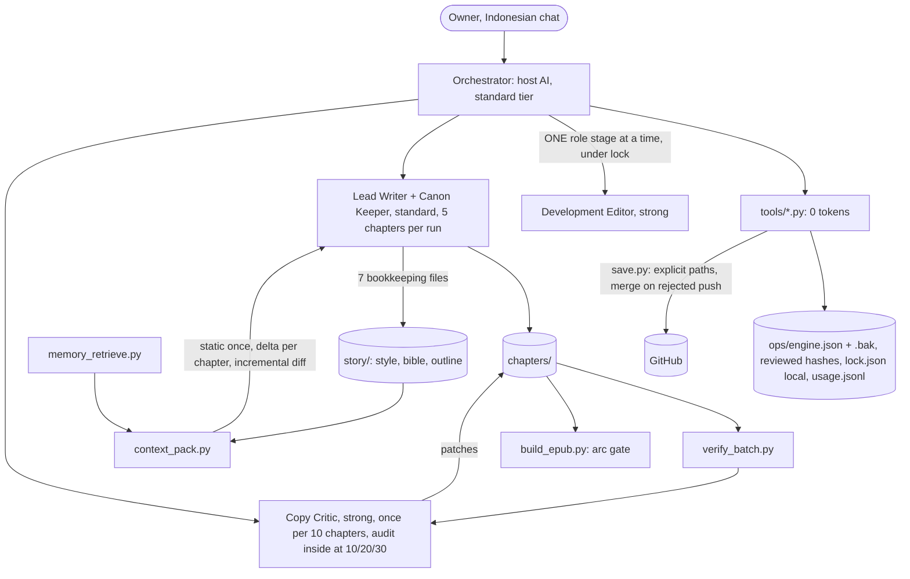

# Anogen Architecture (current main, after the second pass)

Anogen contains no model client. A single host AI (the orchestrator) performs each role itself as a sequential stage, one at a time, from prompt files, and runs the deterministic tools in `tools/` (Python standard library only). Each novel lives in its own folder `novels/<slug>/`; the active one is named in `novels/ACTIVE` (`common.py` resolves it, `ANOGEN_NOVEL` overrides, `ANOGEN_ROOT` keeps the flat layout for tests). Inside a novel the Markdown files in `story/` are the memory; `chapters/` is the authoritative manuscript; `ops/engine.json` is the state machine. Shared engine files are in `engine/` and `templates/novel/`; one global lock (`novels/lock.json`, not committed) keeps a single agent running across all novels.

## Chapter lifecycle

1. `engine_state.py next --no-apply` returns `writer_range` (at most 5, clamped before any existing chapter), `critic_pending` (only when 10 chapters are ready, a batch ended, or an arc ended), `rereview_pending` (edited chapters; blocks `writer_range`), `audit_with_critic`.
2. Writer agent: `context_pack.py --part static` once; per chapter `--part delta --incremental [--batch-start] --retrieve`; writes the chapter, runs `check_chapter.py` and `prepass.py`, updates the memory files, `log_run.py`, `save.py` (one commit per chapter).
3. Orchestrator: `verify_batch.py A-B` (every subprocess and git result checked), `usage_log.py add`.
4. Critic agent (every 10 chapters, after `verify_batch`): patches, run-log, `save.py`; orchestrator then `mark critic B` (records chapter hashes) and `mark audit B`. Edited reviewed chapters: `rereview C ...` (hashes updated for exactly those chapters).
5. Arc end: `arc-complete` (refuses on missing chapters, unreviewed chapters, or chapters edited after review), `build_epub.py --arc K`.

## Story memory layers (what exists)

| Layer | File | Reaches the writer |
|---|---|---|
| Global bible | premise, world, nations... | premise always; others by `--extra` |
| Arc / outline | `outline/arc-K.md`, `series.md` | 3 outline lines, series arc |
| Chapter summaries | `summaries.md` + `archive/` | last 3 always; older ones via retrieval (names) |
| Character state, secrets, debts | `state.md`, `secrets.md`, `debts.md` | full at batch start, then diffs |
| Threads, twists, timeline | `threads.md`, `twists-*.md`, `timeline.md` | via `--retrieve` (name and planned-chapter match, file:line shown) |
| Canon names | `canon_names.txt` | checker, retrieval matching |

Known limits: `state.md`, `debts.md`, `secrets.md` and `characters.md` are still flat files with fixed caps (3,000, 2,900, 2,400 and 3,000 characters); retrieval matches names and planned chapter numbers only (no semantics); the incremental pack relies on the agent keeping its first pack in its conversation (fallback: the same command without `--incremental`).

## State and safety rules

- Writes are atomic (temp file then `os.replace`); `engine.json` keeps a `.bak`; the lock is guarded by an OS file lock and checks the owner on release (local to one machine; there is no cross-container lock).
- `novels/<slug>/ops/ctx-cache.json` and `novels/lock.json` are local, never committed.
- `save.py` stages only project folders (`chapters story ops out docs tools tests roles archive` and the root Markdown files), merges (never force-pushes) on a rejected push, and retries an earlier failed push.
- CI: `.github/workflows/tests.yml` runs `tools/test_tools.py` and `tools/ctx_compare.py` on pull requests; it has no secrets and does not touch the schedule (OFF).
