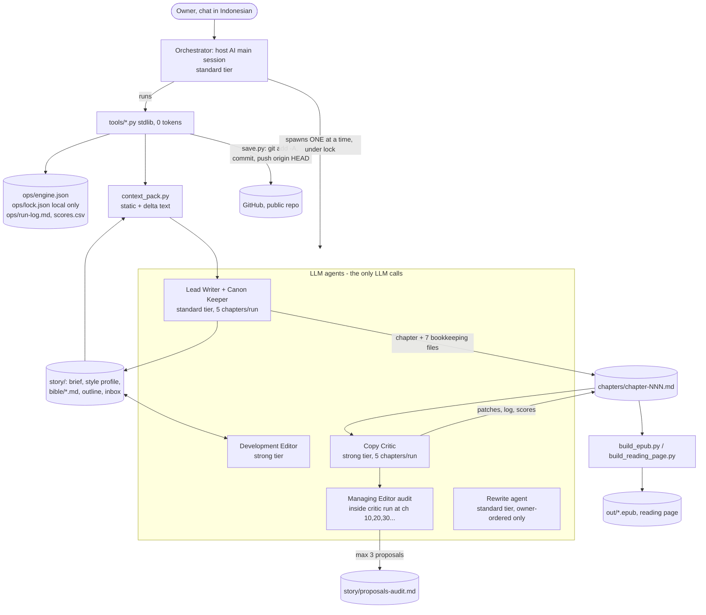
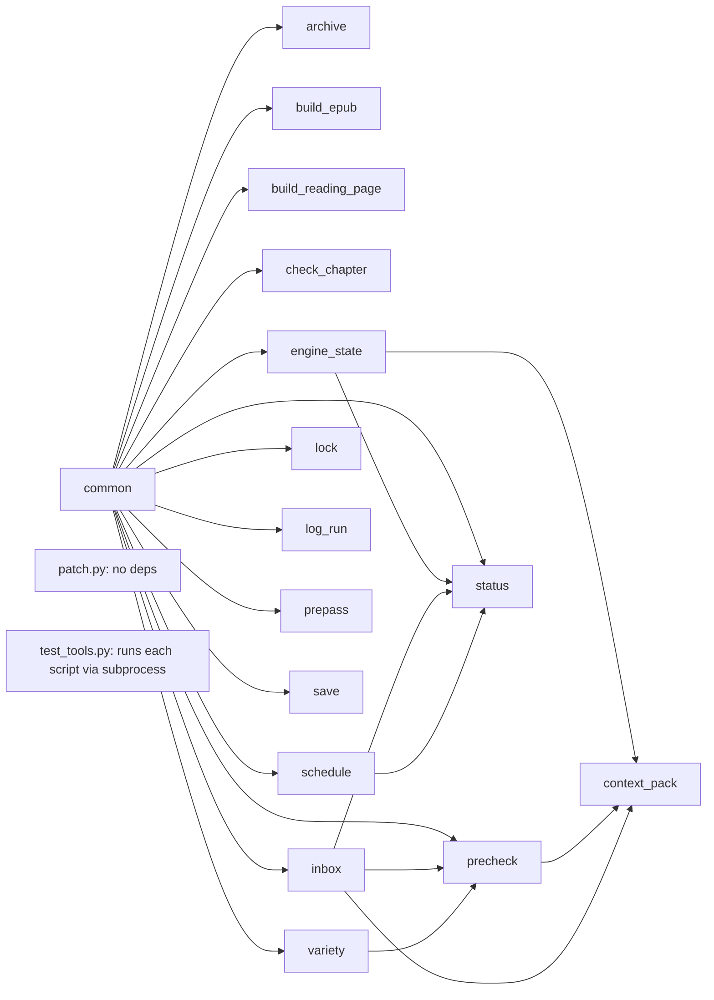

# Anogen Audit Report (Phase One)

Date: 2026-11-25. Scope: the repository as cloned (shallow clone, depth 50, 50 commits visible; see 12.3). No application source was modified. Findings come from reading every file in `tools/`, `roles/`, `ops/`, `AGENTS.md`, `CLAUDE.md`, `README.md`, the story pack, and from experiments run on scratch copies outside the repo.

Labels used throughout: **MEASURED** (observed here, reproducible), **DERIVED** (follows from code by arithmetic, not run live), **ESTIMATE** (char/4 token approximations or judgement), **HYPOTHESIS** (not verified).

---

## 1. Executive Summary

1. **Anogen contains no LLM client code.** Every model call is made by a host AI (Claude Code) that spawns sub-agents from prompt files. The repo is a deterministic toolbox (`tools/`, Python stdlib, ~2,400 lines incl. tests) plus prompts, plus a Markdown "memory". Consequently token usage, cost and retries **cannot be measured from inside the repo**, and today they are **not recorded anywhere**: all 13 `quota_note` fields in `ops/run-log.md` are empty (F-08). No token or cost figure in this audit is measured; the ones given are labelled ESTIMATE.
2. **Highest-value defect found: the writer never receives part of the style profile.** `context_pack.py:96` caps `story/style/profile.md` (13,816 chars) at 9,000, which removes `Voice`, `Prose`, `Chapter shape`, `Freshness`, `Human feel` and `Protagonist voice` and `Battles and aura` (4,419 chars). "Human feel" is LOCKED SETTING 12. The critic reads the file directly, the writer does not (F-01, MEASURED).
3. **Largest measured cost driver is rewrite churn, not generation.** Chapters 1-22 were rewritten in place by three owner-ordered passes after their first draft (`ops/decisions.md` lines 2, 7, 8, 11; visible in git as 12 "readability rewrite" and 24 "style rewrite v3" commits inside the shallow window). That is up to ~3 rewrites for each of 22 chapters (about 66 chapter rewrites, DERIVED) against 25 first drafts. Cause: style rules arrived after the chapters existed and there is no pre-flight style gate (F-07).
4. **The critic gate has a hole.** Chapters 1-20 were rewritten (10:34-10:58) *after* their critic passes and were never re-criticised, yet `critic_through = 25` (`ops/engine.json:20`) is what opens the arc-EPUB gate (`engine_state.py:169`). The `scores.csv` rows 1-22 describe text that no longer exists (F-02, MEASURED from git + run-log).
5. **Story memory is fixed-size and already full at chapter 25 of 50.** `state.md` 2,857/3,000 chars, `debts.md` 2,865/2,900, `characters.md` 2,891/3,000 (pack cap). The writer sees 3 summaries; `threads.md`, `timeline.md`, `twists-*.md`, `arcs-*.md` reach no writer pack; archived summaries are moved to files no tool reads (F-05).
6. **Scale mismatch to decide.** `story/outline/series.md:1` plans **17 arcs, ~850 chapters, ~1.9M words** at the measured 2,204 words/chapter. The mission target is 300-500k words (= 136-227 chapters). The audit does not resolve this; the owner must (F-06).
7. **Scripts are not a bottleneck.** On 500 synthetic chapters the slowest tool call is 286 ms (`status.py`). All real cost is in the LLM context and in repeated work, not in Python (12).
8. **No CRITICAL (data-loss/security) finding was confirmed.** Nothing was lost; the closest items are F-03 (gap-fill can overwrite existing chapters, recoverable through git) and F-04 (no cross-container lock, push without fetch/merge; latent because the schedule is OFF).

Existing strengths worth keeping: one-agent-at-a-time lock, per-chapter commits, `precheck.py` interruption warning, `context_pack` static/delta split, stdlib-only tools, EPUB gate and self-validation, safe-failing JSON loader, 51/51 passing tool tests in 2.5 s.

---

## 2. Repository Overview

| Area | Content | Size (MEASURED) |
|---|---|---|
| `tools/` | 17 scripts + `common.py` + data (`hard_words.txt`, `banned_default.txt`, `variety_menu.json`) + `test_tools.py` | 2,436 lines total with tests |
| `roles/` | 5 role files: development-editor, lead-writer, canon-keeper, copy-critic, managing-editor | 7.4k chars |
| `ops/` | `engine.json` (state), `models.json`, `schedule.json`, `sop.md`, prompts (`batch-writer`, `batch-critic`, 3 rewrite prompts, scheduled task), logs, `scores.csv` | |
| `story/` | brief, `style/profile.md` (13.8k), `bible/` (40+ files), `outline/` (arc-1 29.6k chars), inbox, proposals | ~289 KB incl. docs |
| `chapters/` | 25 chapters, 55,096 words (`status.py`), mean 2,204, min 1,915, max 2,511 | |
| `out/` | 4 committed EPUBs (58-132 KB) | |
| CI / workflows | none (`.github/` absent) | |

Role mapping to the mission's names: Development Editor = `roles/development-editor.md`; Writer = `lead-writer.md` (+ Canon Keeper folded into the writer run per `ops/batch-writer-prompt.md:15`); Manuscript Editor = `copy-critic.md`; Canon Keeper = `canon-keeper.md` (bookkeeping, runs inside the writer agent, not a separate call); Editorial Manager = `managing-editor.md` (runs inside the critic agent every 10 chapters).

**Locked by the owner** (changing any needs the owner's explicit plain-words order, `AGENTS.md` LOCKED SETTINGS, `ops/models.json`): one agent at a time; model tier per role; sequential 5-chapter batches; schedule OFF; English learner level; content limits; arc EPUB only when complete; no re-opening approved bible decisions; forward-only style changes; permanent style orders. The mission's "10/20/30-chapter batches" are interpreted here as runs of sequential 5-chapter batches ("kerjakan N bab"), not as a batch-size change.

---

## 3. Architecture Diagram



Component dependency map (from AST scan, MEASURED; no cycles):



`common.py` is the only shared module. `patch.py` and `test_tools.py` are standalone. `context_pack.py` imports `inbox` dynamically (`context_pack.py:94`, `__import__`).

---

## 4. Actual Execution Flow

```mermaid
sequenceDiagram
  autonumber
  participant O as Orchestrator
  participant T as tools/*.py
  participant W as Writer agent (standard)
  participant C as Critic agent (strong)
  participant G as git/GitHub
  O->>T: engine_state next, lock status, precheck
  T-->>O: writer_range [n..n+4], critic_pending, audit_due_at
  O->>T: lock acquire write
  O->>W: batch-writer-prompt + "range A-B" + trailer
  W->>T: context_pack --part static (once)
  loop each chapter in A..B
    W->>T: context_pack --part delta (writes variety_log.json)
    W->>W: write chapters/chapter-NNN.md
    W->>T: check_chapter, prepass N
    W->>W: edit state, secrets, debts, canon_names, summaries, pacing, threads
    W->>T: log_run, save.py "chapter N" (commit + push)
  end
  O->>T: lock release write, git log / check_chapter verify
  O->>T: lock acquire critic
  O->>C: batch-critic-prompt + "range A-B"
  C->>T: prepass A-B, check_chapter each
  C->>C: read chapter, judge, targeted patch.py
  C->>T: log run-log + scores, save.py "critic pass chapters A-B"
  opt range ends at chapter divisible by 10
    C->>C: managing-editor audit, archive.py, proposals-audit.md
  end
  O->>T: lock release critic, engine_state mark critic B (and audit)
  O->>T: build_reading_page.py, publish; at arc end: arc-complete, build_epub --arc K
```

Lifecycle stages from the mission mapped to code: init/concept/bible/outline/arc planning = Development Editor prompt (`roles/development-editor.md`) + `engine_state.py arc-plan`; chapter generation = writer agent; editorial processing = critic agent + `check_chapter.py`/`prepass.py`; canon validation = `check_chapter.py:104-117` (unknown capitalised names) + critic judgement; memory update = writer's bookkeeping step (7 Markdown files); persistence = `save.py` (one commit per chapter); batch = `engine_state.py` modes `n`/`arc`; EPUB = `build_epub.py` with release gate; scheduling = `schedule.py` (records a wish; the host creates the task; OFF).

---

## 5. Component Dependency Map

See section 3 (second diagram). Notes:

- State mutation points: `engine_state.py` (engine.json), `lock.py` (lock.json), `log_run.py` (run-log.md, scores.csv), `variety.py` (story/variety_log.json), `inbox.py` (inbox.md), `archive.py` (summaries, run-log), `schedule.py`, and the LLM agents themselves (bible files, chapters).
- Read-only claims that are false: `engine_state.py next` writes state (`:141`, `apply=True`); `context_pack.py --part delta` / `precheck.py` write `variety_log.json` unless `--peek` (`precheck.py:49`, `variety.py:33-35`).

---

## 6. LLM Call Inventory

The repo has **zero** direct provider calls (`grep` for anthropic/openai/requests/urllib: none). Calls occur where the orchestrator spawns an agent. Token figures: ESTIMATE = chars/4; "floor" = only what the repo explicitly injects, excluding the agent's own file reads, tool output, reasoning, output and conversation accumulation.

| # | Call site / prompt | Tier (ops/models.json) | When | Injected by repo | Output stored | Repeated work |
|---|---|---|---|---|---|---|
| 1 | Orchestrator session | standard | whole run | `AGENTS.md` 7.3k + `sop.md` 6.4k + `PORTABILITY.md` chars read at start (`CLAUDE.md`) | none (chat) | context grows over an unlimited-length run (`sop.md:47`) |
| 2 | Development Editor, `roles/development-editor.md` | strong | arc planning, inbox, new story | reads profile (13.8k), brief, inbox, threads (5.1k), debts, state, characters, **arc-1.md (29.6k)**, other bible files | `story/outline/arc-K.md`, bible files, research, epigraphs | whole current arc outline re-read at each planning |
| 3 | Lead Writer + Canon Keeper, `ops/batch-writer-prompt.md` (3.8k) + `lead-writer.md` (1.9k) + `canon-keeper.md` (0.9k) | standard | every 5 chapters | static pack 23.6k chars (~5.9k tok, once per batch) + delta 16.4k chars (~4.1k tok) per chapter | chapter + 7 bookkeeping files + run-log + commit | state/debts/secrets/summaries re-delivered each chapter although the same agent just rewrote them (F-20) |
| 4 | Copy Critic, `ops/batch-critic-prompt.md` (2.6k) + `copy-critic.md` (1.0k) | strong | every 5 chapters | reads 5 chapters (~2.9k tok each ESTIMATE), prepass output, profile parts | patches, run-log, scores.csv | mechanical issues already fixed by writer's own check/prepass run (see F-21) |
| 5 | Managing Editor audit, `roles/managing-editor.md` (0.7k) | strong | inside critic run ending at ch 10/20/30 | last 10 summaries, scores.csv, run-log lines | ≤3 proposals in `proposals-audit.md`, banned.md, variety menu | F-11: trigger fragile |
| 6 | Rewrite agents: `ops/rewrite-prompt.md`, `readability-rewrite-prompt.md`, `simple-rewrite-prompt.md` | standard | owner order only | AGENTS.md 7.3k + profile 13.8k (full) + banned + lead-writer + armor 9.0k, then chapter + summary | in-place chapter replacement | three overlapping prompts, two obsolete; F-07 |
| 7 | Scheduled task `ops/scheduled-task-prompt.md` | host-defined | schedule OFF | n/a | n/a | not exercised |

Per 5-chapter writer batch, repo-injected floor (ESTIMATE): 5.9k + 5 × 4.1k + (3.8+1.9+0.9)k chars/4 ≈ **28k tokens**, before chapter output (~2.9k tok × 5) and the agent's bookkeeping reads/edits. Critic floor (ESTIMATE): 5 × 2.9k + ~0.9k prompts + ~3.5k profile ≈ **19k tokens** plus its own output. These cannot be validated without provider usage data (F-08).

---

## 7. Token Efficiency Audit

Measured pack composition (`context_pack.py --part static --extra combat-style` = 23,617 chars; `--part delta` = 16,362 chars; full = 39,991 chars, cap `context_pack_max_chars` 40,000 in `story/brief.md`):

| Section | Cap in code | Actual | Note |
|---|---|---|---|
| Style profile | 9,000 (`:96`) | 13,816 file | **truncated at 9,000, mid-sentence** (F-01) |
| Banned | 2,500 | within | |
| Series arc | 3,000 | 2,890 | whole file |
| Characters | 3,000 (`:114`) | 2,891 | 109 chars from cap (F-05) |
| Premise | 2,500 | within | |
| Extras | 9,500 each (`:126`) | `combat-style` 5.7k | chosen by the orchestrator |
| State | 3,500 | 2,857 | |
| Debts (open only) | 3,000 | 2,865 file | |
| Secrets | 2,600, tail-only (`:112`) | 2,083 | |
| Last summaries | 3,500, k=3 (`:116`) | 3 × ~1.0k | |
| Previous tail | 2,200, 300 words | | |

Findings: F-01 (truncation), F-20 (re-delivery inside a batch), F-14 (style rules restated in 5 places: `AGENTS.md` locked 12, `profile.md`, writer prompt, `lead-writer.md`, rewrite prompts, with inconsistent numbers), F-22 (armor/twist/timeline detail depends on the writer remembering to pass `--extra`). Opportunities are costed in `OPTIMIZATION_ROADMAP.md`.

---

## 8. Hierarchical Memory Audit

| Mission layer | Exists? | Where | Reaches writer? | Gap |
|---|---|---|---|---|
| 1 Global Story Bible | yes | `premise.md`, `world.md`, `nations.md` ... 40 files | premise 2.5k + extras by choice | no deterministic selection |
| 2 Arc-level memory | partial | `story/outline/arc-1.md` (per-chapter lines), `arcs-1..4.md`, `twists-1/2.md` | 3 outline lines only | no arc summary of what *happened*; archived summaries are not replaced by one |
| 3 Chapter summaries | yes | `summaries.md` (live), `archive/` (old) | last 3 | archived files read by no tool (`archive.py:27`) |
| 4 Character state | yes | `state.md` (hard cap 3,000 chars, `batch-writer-prompt.md:15`) | yes | one flat file; no per-character; 95% full |
| 5 Canon facts | partial | `canon_names.txt`, bible files | names only used by checker | no structured facts (numbers, ranks, dates) |
| 6 Timeline | file exists | `timeline.md` 5.6k | **no** | not in any pack; day-count errors found by critic at ch 23 (run-log line 80) |
| 7 Relationship state | partial | inside `state.md` ("Relationships"), `romance.md` | state only | |
| 8 Unresolved threads | yes | `debts.md` (≤2,900), `threads.md` (5.1k ledger) | debts only | debts dropped for space "become a line in threads.md" (`batch-writer-prompt.md:15`) which is **never injected** |
| 9 Active chapter context | yes | delta pack | yes | static+delta cap tuned by hand |

Verdict: the layers exist as hand-compacted Markdown, but selection is "recency + fixed cap", not narrative relevance. There is no provenance (chapter references per fact), no reconciliation against the manuscript, and no way to pull "who knows what about the glass floor" without the writer reading files by itself. At 3,000 chars per memory file, the design is saturated at ~25 chapters; at 136-227 chapters (mission target) or 850 (series plan) it will force continual silent loss. Recommended approach is incremental and keeps Markdown as source of truth (see roadmap P1-3, P1-4): add provenance tags (`[ch 12]`) to existing lines, deterministic per-chapter selection from the outline's own names, and an arc-level rolling summary that replaces the unread archive.

---

## 9. Editorial Workflow Audit

| Role | Per chapter? | Could be arc-level / conditional | Overlap | Deterministic part already in code |
|---|---|---|---|---|
| Development Editor | no (per arc / inbox) | already conditional | | `arc-plan` registration |
| Writer | yes | n/a | | `check_chapter`, `prepass`, variety draw |
| Canon Keeper | yes, inside writer | summary/state edits are mechanical rewrites of Markdown | overlaps writer's self-score | unknown-name check only |
| Manuscript Editor (critic) | per 5 | could be conditional on prepass/check results plus a continuity sample | readability fixes duplicate writer's own prepass fixes | `prepass.py` |
| Editorial Manager | per 10, merged | | partly duplicates critic's recurring-weakness report | `archive.py` |

Evidence the strong-tier critic is catching real continuity errors (run-log lines 80-82: day count, attacker count 40 vs 20, character facts), i.e. **canon errors are caught after drafting, at strong-tier cost, because no deterministic facts layer exists**. Do not remove the critic. Candidates (all inside locked settings, therefore "owner order required" for any tier/batch change): feed the critic only the chapters + prepass + diffed memory files; make mechanical issues a hard gate before the critic starts so the critic does not spend tokens on them; keep critic always-on (owner rule) but add a deterministic continuity pre-check that gives it a shorter, sharper list.

`scores.csv` is not a usable quality metric: 25 rows, values only 3 or 4 (69 threes, 72 fours, no 1, 2 or 5), authored first by the writer then edited by the critic (F-16).

---

## 10. Batch Generation Audit

- Modes: `n` (target N) and `arc` (planned arc, max M). `writer_range = [n, min(n+4, limit)]` (`engine_state.py:93`). Larger runs (10/20/30/50+) are sequential 5-chapter batches under `ops/sop.md` section 2; no session limit (owner order).
- Context accumulation is bounded per agent (fresh agent per 5 chapters) which is good; accumulation inside an agent over 5 chapters is unmeasured (F-08).
- Resume: `batch-resume`, `precheck` warning for a highest chapter without a summary (`precheck.py:63-68`), `ops/blocked.md` retry list. Strong for "died between chapters"; weak for "died inside bookkeeping" (state updated, summary missing is caught; summary present but `debts.md` stale is not).
- F-03: after a gap, `next_chapter_number()` returns the gap (`common.py:70-75`) and `writer_range` extends across existing chapters. MEASURED: with chapter 20 removed from a copy, `writer_range = [20, 24]` while 21-24 exist; no no-clobber check exists in prompt or tools.
- F-11 (DERIVED): `critic_pending = [critic_through+1, highest]` (`:96-97`). If a writer batch is interrupted so that chapters stop at 28 with `critic_through=28`, later ranges are 29-33, 34-38, 39-43 ... none ends on a multiple of 10, so the critic prompt's trigger ("range ends at a chapter divisible by 10", `batch-critic-prompt.md:14`) never fires although `audit_due_at` (`engine_state.py:98-99`) stays set. Same with `mode n` and non-multiple-of-5 targets (E2: ranges of 3 skip the audit at 30).
- Parallelism: not applicable to dependent narrative generation (owner order: one agent at a time). Safe parallelism exists only in 0-token work (checks of several chapters, EPUB build); gain is milliseconds (12), so recommended: none.
- Persistence: one commit per chapter containing chapter + bookkeeping (atomic enough at git level), pushed immediately. Risk F-04 on push rejection.

---

## 11. Canon Consistency Audit

Tracked today: character state, secrets, debts, threads, timeline (not injected), canon names. Deterministic checks: only capitalised words appearing ≥ 2 times and absent from `canon_names.txt` (`check_chapter.py:104-117`; a one-off wrong name or a wrong number is invisible), repeated n-grams, banned phrases, readability numbers. All 25 chapters pass `check_chapter` (25/25 OK, MEASURED), mean sentence length 9.0 (near the lower limit of the allowed 8.5-13.5), dialogue 25-45% (mean 29%): the numeric gate is satisfied but sits at the edge of its own limits, a Goodhart risk for text that must also feel human.

Structured state could cut repeated LLM analysis only if it stays reconcilable with the manuscript: each fact should carry a chapter reference and be re-derivable from the chapter text by the critic's diff step. No such layer exists (roadmap P1-4).

---

## 12. Performance Audit

### 12.1 Script timing (MEASURED, median of 3, this container)

| Tool call | real, 25 chapters | synthetic 500 chapters |
|---|---|---|
| `check_chapter.py` (one chapter) | 52 ms | 65 ms |
| `prepass.py` 5 chapters | 210 ms | 242 ms |
| `context_pack.py --part delta --peek` | 43 ms | 73 ms |
| `status.py` | 46 ms | 286 ms |
| `engine_state.py show` | 37 ms | 44 ms |

Synthetic set = the 25 real chapters repeated to 500 files (a scale test of the tools only, not of memory quality). Verdict: CPU, filesystem and git are **not** bottlenecks up to 500 chapters. `status.py` is O(N) because it re-counts words in every chapter and calls `compute_next` twice (`status.py:14,17,24`); irrelevant at this scale. Do not spend effort here.

### 12.2 Wall clock of agent work (MEASURED from log timestamps and commit times; not agent start times)

- First drafts (run-log, 2026-11-24): chapters 1-10 logged 02:08 to 02:30 WIB, ≈ 2.4 min/chapter; chapters 14-15 logged 2 min apart; chapters 23-25 commits 11:05:18, 11:07:13, 11:09:29 (≈ 2.0 min/chapter).
- Critic pass 23-25: previous commit 11:09:29, critic commit 11:12:12 (2 min 43 s for 3 chapters).
- Rewrites: readability rewrite of chapters 11-22 spans 07:24:03-07:29:58 (12 chapters, ≈ 30 s each); v3 rewrite of 1-22 spans 10:34:53-11:00:47 (≈ 71 s per chapter including a retry and an owner-instruction commit in between).

### 12.3 Shallow history

`git rev-parse --is-shallow-repository` = true; the oldest visible commit is `6600b51`. Any per-chapter commit count in this report is a **lower bound**. The first drafts are only visible through `ops/archive/run-log-1.md`.

---

## 13. Reliability Audit

Strengths: `load_json` refuses to proceed on corrupt JSON and says nothing was overwritten (`common.py:48-49`); per-chapter commit; lock with TTL; precheck interruption warning.

Weaknesses: F-03, F-04, F-09 (non-atomic writes), F-10 (lock TOCTOU, no owner check on release), F-12 (state-mutating "read" commands), F-13 (checker never fails), F-23 (non-idempotent logging: `log_run.py:40-50` appends blindly, so a retried chapter doubles run-log and `scores.csv` rows). No retry/backoff exists in code for push (2 immediate attempts, `save.py:42-48`); no timeouts exist for anything (subprocess git calls have none, `save.py:11`).

Experiment (MEASURED): 12 parallel `lock.py acquire` on a free lock gave 1 success, 11 `BUSY` exit 3, no corrupt `lock.json`. The race is therefore **not reproduced** here; the code is still non-atomic by construction (`lock.py:39,56-57`).

---

## 14. Security Audit

- No credentials, tokens, keys or the owner's email found in the tree (pattern search over all files outside `.git`; hits for "secret/token" are story vocabulary). Commit author email is `noreply@anthropic.com` for all 50 visible commits. The repo is public **on purpose** (`ops/PORTABILITY.md:7`).
- `save.py:24` runs `git add -A`: any file the agent or a tool drops in the tree is committed and pushed to a public repo. `.gitignore` has 4 lines. Risk is LOW today (no secrets in workflow) but it is the only gate (F-19).
- Subprocess use: git only, argv lists, no shell (`save.py:11`). Good.
- `patch.py:17` writes to any path given as argument; only the agents call it. LOW.
- `ANOGEN_ROOT` env var redirects every tool's root (`common.py:7`); intended for tests.
- Committed Claude session URLs in three rewrite prompts (`ops/rewrite-prompt.md:15`, `readability-rewrite-prompt.md:14`, `simple-rewrite-prompt.md:14`) and hard-coded `/home/claude/anogen` paths: not secrets, but they are session identifiers in a public repo and are stale (F-15).
- Governance note (not a vulnerability): `ops/sop.md` section 0 pre-authorises push, publish and edits without asking. This conflicts with the mission rule "never push without explicit authorization" for this audit; this audit follows the stricter rule.

---

## 15. Maintainability Audit

Dead/unused (MEASURED by AST scan): `engine_state.py:82` dead assignment `hi = ...` (overwritten at `:85`); unused imports `common.chapter_title` (`build_epub.py:19`, `precheck.py:10`), `common.CHAPTERS` and `chapter_files` (`context_pack.py:14`); `common.last_chapters` (`common.py:158`) used nowhere; unused variable `ends` (`check_chapter.py:166`). Duplication: scene-break regex in `common.py:27` and `build_epub.py:41`; two independent Markdown-to-HTML converters (`build_epub.py:32-94`, `build_reading_page.py:28-45`) with different emphasis handling. Stale/duplicated prompts: three rewrite prompts for the same job. Tests: `test_tools.py` 51 PASS / 0 FAIL, 2.5 s, integration style, covers variety, precheck, context_pack sections, checker, engine, lock, patch, schedule, save; **no CI** to run it; **no test** for truncation, gap-fill, audit trigger, idempotent logging, or archive round trip (F-18). Documentation is rich but inconsistent (F-14) and mixes Indonesian (README, owner chat) and English by design.

---

## 16. Critical Findings

None confirmed as CRITICAL. HIGH: F-01, F-02, F-03, F-04, F-05, F-07, F-08. Detailed entries in section 17.

---

## 17. Optimization Opportunities (findings catalogue)

Format per finding: ID | severity | category | evidence | current behaviour | why it matters | recommendation | expected benefit | complexity | risk | validation. "Owner order" = touches a LOCKED SETTING.

### F-01 | HIGH | LLM context / quality
- **File:line**: `tools/context_pack.py:22-24` (`cap`), `:96` (profile, 9000); `ops/batch-writer-prompt.md:7,13`; `story/style/profile.md` (13,816 chars; sections Voice at offset 9,397 onward).
- **Current**: the static pack ends the profile at 9,000 chars inside "READABILITY", with a bare `[...truncated]`. The pack-level "lost sections" note (`:128-134`) does not fire because the cut is per-section. MEASURED: the pack text stops at "make the".
- **Why it matters**: the writer prompt tells the writer to obey Human feel and Protagonist voice; they are locked orders (setting 12) but never delivered. Critic reads them from file, so the writer is judged on rules it never saw. Quality drift since the style was extended (the sections were appended after the cap was set).
- **Recommend**: do not raise a magic number; build the pack by section priority (LEVEL, CLARITY, SCENE FEEL, READABILITY, Human feel, Protagonist voice first; Voice/Prose/Freshness condensed), make any truncation fail loudly (nonzero exit, named section), add a size budget check to the audit.
- **Benefit**: restores 4.4k chars (~1.1k tokens ESTIMATE, +~4% of a batch's injected context) of required rules; removes a silent failure class. **Complexity** low. **Risk** low (more text for the writer). **Validation**: unit test asserting every `##` section of a fixture profile appears or the tool exits non-zero; before/after pack diff.

### F-02 | HIGH | Quality gate / canon
- **File:line**: `ops/engine.json:20-21`; `engine_state.py:96-97,169,194-197`; `ops/rewrite-queue.md:10`.
- **Current**: the v3 rewrite of 1-22 ran 10:34-11:00; critic commits exist only for 21-22 (`92be14c`, 11:02:53) and 23-25 (`119ef1c`, 11:12:12). Run-log critic entries for 11-20 (lines 12-16, 43-47) pre-date the v3 text. `rewrite-queue.md:10` promises "the next normal critic pass covers the new text", but `critic_pending` only ever covers `critic_through+1..highest`, and `mark critic N` accepts any N.
- **Why**: current text of chapters 1-20 has never been reviewed by the strong-tier critic; `arc-complete` (`:169`) and therefore the arc EPUB will be released on a `critic_through` that does not describe them. The rewrite changed sentences, and the critic's earlier canon fixes (run-log) may have been reworded away.
- **Recommend**: record `critic_text_hash` (or per-chapter reviewed hash) so a chapter changed after review is pending again; make `mark` refuse to skip chapters; run one critic pass over 1-20 when the owner orders it (this is a spend decision for the owner).
- **Benefit**: closes the gate; makes rewrites auditable. **Complexity** low-medium. **Risk** low. **Validation**: test that editing a reviewed chapter makes it reappear in `critic_pending`.

### F-03 | HIGH | Data safety
- **File:line**: `common.py:70-75`, `engine_state.py:93`, `ops/batch-writer-prompt.md:11-13`.
- **Current**: lowest-gap-first numbering plus a fixed 5-wide range. MEASURED on a scratch copy: chapter 20 absent, 21-25 present, `writer_range = [20, 24]`.
- **Why**: writer would overwrite chapters 21-24 and append duplicate summaries; recoverable from git only if someone notices.
- **Recommend**: clamp the range at the next existing chapter, and refuse (exit non-zero) to write to an existing file unless an explicit rewrite flag is given; report the gap to the orchestrator.
- **Benefit**: removes an overwrite path. **Complexity** low. **Risk** low. **Validation**: test with a gap.

### F-04 | HIGH (latent) | Reliability
- **File:line**: `.gitignore:3`, `lock.py:17`, `save.py:42-48`.
- **Current**: `ops/lock.json` is not committed, so two containers (a scheduled task and a chat session, or two chat sessions) share no lock. `save.py` pushes `origin HEAD`, retries immediately once, and on rejection leaves commits only in an ephemeral container (the platform reclaims it).
- **Why**: with the schedule ON or two chats open, divergent histories and lost work are possible; `ops/engine.json` and bible files would merge-conflict.
- **Recommend**: on push rejection fetch and merge (never force), back off between attempts; use the remote as the lock (a lock commit or branch ref) only if the owner enables the schedule; document single-writer rule until then.
- **Benefit**: no stranded work. **Complexity** medium. **Risk** medium (git semantics). **Validation**: test with two local clones and a bare remote.

### F-05 | HIGH | Memory / scalability
- **File:line**: `ops/batch-writer-prompt.md:15` caps; `context_pack.py:109-116,60-69`; `archive.py:16-32`.
- **Current** (MEASURED sizes): state 2,857/3,000; debts 2,865/2,900; secrets 2,083/2,400; characters 2,891/3,000; writer sees 3 summaries; threads/timeline/twists/arcs reach no pack; archived summaries have no reader.
- **Why**: fixed caps force the LLM bookkeeping step to drop information each chapter; at 136-227 chapters this is lossy, and losses are invisible.
- **Recommend**: keep Markdown as the source of truth; (a) add chapter provenance tags; (b) add a rolling arc summary that replaces the unread archive; (c) select threads/timeline/twists lines whose names or chapter ranges match the outline line; (d) cap per-file size by line count, not by one flat file.
- **Benefit**: bounded context with less loss. **Complexity** medium-high. **Risk** medium (quality), mitigated by feature flag and A/B on fixed chapters. **Validation**: golden-chapter fixtures; compare retrieved facts to a hand-made list.

### F-06 | MEDIUM (decision) | Scope
- `story/outline/series.md:1`: 17 arcs, ~850 chapters; `archive.py:2` mentions a 600-chapter run. At 2,204 words/chapter that is ~1.9M words versus the mission's 300-500k (136-227 chapters, ≈ arcs 1-4/5). Not resolved here; it determines how much of F-05 must be built. Owner decision.

### F-07 | HIGH | Cost / process
- **Evidence**: `ops/decisions.md:2,7,8,10,11`; git: 12 "readability rewrite" + 24 "style rewrite v3" commits in the visible window; `rewrite-queue.md` v3 covers 1-22.
- **Current**: rules were tightened three times in one day and applied backwards each time (forward-only rule, decisions line 10, was overridden within the hour, line 11).
- **Why**: DERIVED ~66 chapter rewrites for 25 first drafts; each rewrite emits a full chapter plus reads ~49k chars (rules + armor.md + the chapter; ESTIMATE ≈ 12k tokens input each). Tokens unmeasured.
- **Recommend**: a style-change protocol: change profile → run a 1-chapter canary rewrite → deterministic checker + owner read → only then bulk rewrite; keep a single parameterised rewrite prompt; retire the two obsolete ones.
- **Benefit**: avoids repeating the largest measured expense. **Complexity** low (process + one prompt). **Risk** low. **Validation**: next style change count of rewrite passes.

### F-08 | HIGH | Observability
- **File:line**: `log_run.py:23,40` (`--quota-note` free text), `README.md:23`; MEASURED: 13/13 `quota_note` empty.
- **Current**: no tokens, calls, duration or retries recorded; not available to repo code.
- **Recommend**: a `usage.jsonl` appended by the orchestrator after each agent (role, model, tier, range, input/output/cache tokens **as reported by the host's agent result if it provides them**, wall time, outcome); `tools/usage_report.py` for cost per chapter/1,000 words/arc. Whether Claude Code's agent result exposes usage is **unverified**; if not, fall back to the owner's usage page deltas, labelled manual.
- **Benefit**: makes every later claim measurable. **Complexity** low. **Risk** none. **Validation**: dry-run with a fixture.

### F-09 | MEDIUM | Reliability
- `common.py:37-40,52-53`: plain `write_text` for `engine.json`, `lock.json`, `variety_log.json`, run-log, summaries, inbox. A crash mid-write truncates the file; the loader then halts the engine (safe) but offers no backup. **Recommend** write-temp-then-`os.replace` and one rolling `.bak` for `engine.json`. Low complexity; test by killing a writer thread.

### F-10 | MEDIUM-LOW | Reliability
- `lock.py:39,56-57`: read-modify-write; `:59-62` release ignores owner; fixed 120 min TTL without heartbeat (`:34`). MEASURED: no corruption in a 12-way race (1 winner). **Recommend** `os.open(O_EXCL)` or `mkdir` as the atomic primitive and owner check on release.

### F-11 | MEDIUM | Process logic
- See 10 (DERIVED). **Recommend** audit trigger based on state (`audit_through < floor(critic_through/10)*10`), not on the shape of the current range; make `mark` validate monotonic, existing chapters.

### F-12 | MEDIUM | Idempotency
- `engine_state.py:141` (`next` mutates), `precheck.py:49` + `variety.py:20-36` (draw logged on read; RNG unseeded `:27`). **Recommend** separate `next` (pure) from `next --apply`; context pack always peeks, the writer's chapter save commits the draw.

### F-13 | MEDIUM | Quality gate
- `check_chapter.py:2,168-173` always exits 0; `precheck.py:63-68` only checks the highest chapter's summary. **Recommend** `--strict` exit code and a `verify_batch.py A-B` that checks per chapter: file, word range, summary, canon names registered, scores row present, committed. Gives the orchestrator a deterministic go/no-go before spawning the critic.

### F-14 | MEDIUM | Prompt consistency
- Targets differ: `sop.md:28` (avg 8-13, dialogue 25-35%), `profile.md` LEVEL (6-12 mostly) and CLARITY (9-12, 25-40%), `check_chapter.py:143,145` (8.5-13.5), writer prompt (body 2000-2400) vs brief (1800-2500). **Recommend** single source (`profile.md` Machine-readable block read by both checker and prompts), reference elsewhere.

### F-15 | LOW-MEDIUM | Hygiene / privacy
- Three rewrite prompts with `/home/claude/anogen` and committed session URLs. **Recommend** merge into one parameterised prompt, drop hard-coded identifiers (the trailer is supplied by the host per `AGENTS.md`).

### F-16 | MEDIUM | Quality measurement
- `scores.csv`: 25 rows, only 3/4. Writer self-scores, critic edits. **Recommend** keep as a coarse signal; build the quality baseline from deterministic metrics (checker stats, repetition, canon-name registrations, critic-found canon errors per batch counted from the run-log) plus a blind human read of a fixed sample; do not use one LLM scorer as proof.

### F-17 | LOW | Dead code
- Items in section 15. **Recommend** remove in a P3 cleanup commit with tests green.

### F-18 | MEDIUM | Tests/CI
- No CI; no tests for F-01, F-03, F-11, idempotent logging. **Recommend** add a GitHub Action running `python3 tools/test_tools.py` (needs owner authorization because workflows touch the public repo's automation) and the new tests.

### F-19 | LOW | Repository hygiene
- `save.py:24` `git add -A`; four EPUBs (58-132 KB, ~390 KB total) committed in `out/`, growing each time. **Recommend** stage explicit paths (chapters, story, ops, out for released arcs) and ignore partial EPUBs after delivery.

### F-20 | MEDIUM | LLM efficiency
- Delta pack re-sends state/debts/secrets/summaries (up to ~12.6k chars ≈ 3.2k tokens ESTIMATE) for chapters 2-5 of a batch, which the same agent just rewrote. **Recommend** per-chapter pack = changes since the previous chapter (diff) + unchanged files referenced by hash; the first chapter of the batch gets everything. ESTIMATE saving ≈ 10-13k tokens per 5-chapter batch (~35-45% of the repo-injected floor), to be validated after F-08.

### F-21 | MEDIUM | Editorial orchestration
- Mechanical fixes (long sentences, hard words) listed by `prepass.py` are given to the strong-tier critic's prompt although the writer already ran the same tool. **Recommend** orchestrator runs `verify_batch.py` first and passes the critic only the residual list plus the continuity checklist; critic always still reads the chapters (owner rule). Tier and agent count unchanged.

### F-22 | MEDIUM | Memory selection
- `armor.md` is a locked requirement (setting 12) but its text reaches the writer only if the orchestrator passes `--extra armor`; writer prompt names only `combat-style` (`batch-writer-prompt.md:7`). **Recommend** choose extras from the outline line's `type:` (battle → combat-style, armor when the line says armor).

### F-23 | LOW | Idempotency
- `log_run.py:40-50` appends duplicates on retry. **Recommend** replace-by-chapter semantics.

---

## 18. Prioritized Roadmap

See `docs/OPTIMIZATION_ROADMAP.md`. Phase Two starts only after the owner reviews and authorises it; locked-setting items need the owner's explicit order.
